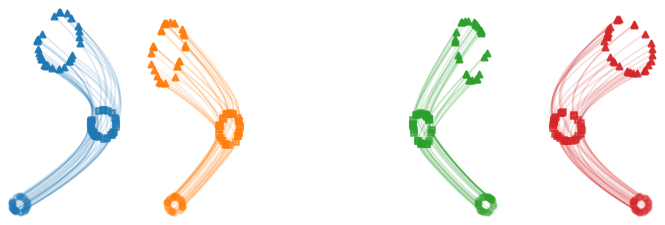
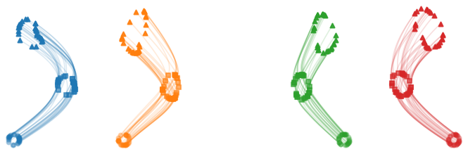
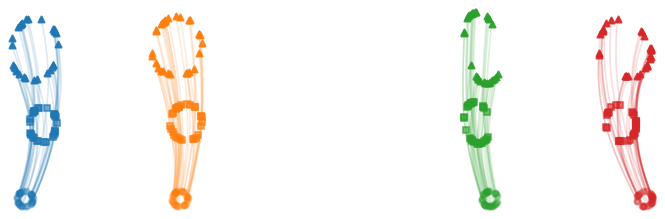
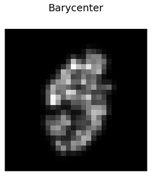
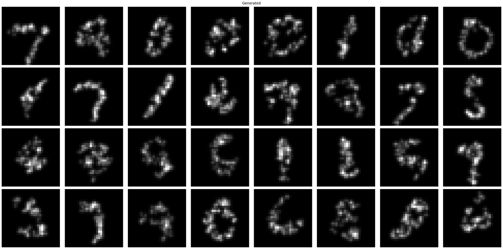

# Generalized Wasserstein Flow Matching: Nested Couplings for Point Cloud Generation

This repository contains the code for the **circle** experiment (Sec. 4.2 and its ablations) and the **MNIST point cloud**
experiment (Sec. 4.3, including the batch size 64 comparison, the pure noise ablation and the NSOT comparison) of

> Moritz Piening, Richard Duong, Gabriele Steidl.
> *Generalized Wasserstein Flow Matching: Nested Couplings for Point Cloud Generation.*
> NeurIPS 2026. [arXiv:2605.08424](https://arxiv.org/abs/2605.08424)

We view a point cloud $`\mathbf{x}\in\mathbb{R}^{N\times d}`$ as the empirical measure
$`\hat\mu=\frac1N\sum_{i=1}^N\delta_{\mathbf{x}_i}\in\mathcal{P}_2(\mathbb{R}^d)`$. A data set of point clouds is then a
*metameasure* $`\hat{\boldsymbol{\nu}}\in\mathcal{P}_2(\mathcal{P}_2(\mathbb{R}^d))`$.
Flow matching from a source metameasure $`\hat{\boldsymbol{\mu}}`$ to $`\hat{\boldsymbol{\nu}}`$ in this
Wasserstein-on-Wasserstein (WoW) space requires transport plans on two levels:

* an **outer plan** $`\mathrm{OP}`$, which decides which source cloud $`\hat\mu`$ is sent to which target cloud $`\hat\nu`$,
* an **inner plan** $`\mathrm{IP}(\hat\mu,\hat\nu)`$, which decides which point of $`\hat\mu`$ is sent to which point of $`\hat\nu`$.

For a batch of $`B`$ source and target clouds, the outer plan reorders the targets and the inner plan reorders the points
of each target into $`\mathbf{x}'`$. We train the velocity field $`V_\theta`$ with

```math
\hat{L}_{\mathrm{WoW}}(\theta)=\frac1B\sum_{b=1}^B\|V_\theta(t,(1-t)\mathbf{x}_b+t\,\mathbf{x}'_b)-(\mathbf{x}'_b-\mathbf{x}_b)\|^2,\qquad t\sim\mathrm{Unif}[0,1].
```

New samples are generated by Euler steps for $`\dot{\mathbf{x}}=V_\theta(t,\mathbf{x})`$.

## Transport plans

| Paper | `ot.inner` | `ot.outer` | Implementation |
|---|---|---|---|
| $`\mathrm{IP}_{\mathrm{ind}}`$ / $`\mathrm{OP}_{\mathrm{ind}}`$ | `ind` | `ind` | random permutation of the points / random pairing of the clouds (shuffled data loader) |
| $`\mathrm{IP}_{\mathrm{W}}`$ / $`\mathrm{OP}_{\mathbf{W}}`$ | `w` | `w` | exact OT (`ot.emd`) between points / between clouds with cost $`\mathrm{W}_2^2(\hat\mu_b,\hat\nu_{b'})`$ |
| $`\mathrm{IP}_{\mathrm{SW}}`$ / $`\mathrm{OP}_{\mathbf{SW}}`$ | `sw` | `sw` | average of sorting plans along $`\sharp\mathrm{Slices}`$ random directions / outer cost $`\mathrm{SW}_2^2`$ |
| $`\mathrm{IP}_{\mathrm{LLW}}`$ / $`\mathrm{OP}_{\mathbf{LLW}}`$ | `llw` | `llw` | lazy linear plans based on a fixed barycenter $`\hat\rho`$ of the training clouds (see below) |

With `ot.method: sinkhorn`, both `ot.emd` calls are replaced by `ot.sinkhorn` with regularization `ot.reg`.

**Lazy linear plans.** Before training, every training cloud $`\hat\nu_i`$ is matched once to the barycenter
$`\hat\rho`$. This fixes an ordering $`\mathbf{x}_{\hat\nu_i}`$ of its points. The barycentric noise source (see below)
already has the point order of $`\hat\rho`$. Thus, the inner plan $`\mathrm{IP}_{\mathrm{LLW}}=(\mathrm{id},T_{\hat\nu,\hat\rho})_\sharp\hat\mu`$
is a stored permutation, and the outer cost is the squared Euclidean distance between the ordered clouds. For the
barycentric noise source, no OT problem has to be solved during training.

## Installation

```bash
pip install -r requirements.txt
```

We tested the code with Python 3.11, PyTorch 2.10, POT 0.9.6 and NumPy 1.26. A CUDA GPU is used if available.
All commands are run from the repository root. Set `PYTHON=/path/to/python` to choose the interpreter for the shell
scripts. MNIST is downloaded to `data/mnist` by torchvision on first use.

## Circle experiment (Sec. 4.2)

| $`(\mathrm{OP}_{\mathrm{ind}},\mathrm{IP}_{\mathrm{ind}})`$ | $`(\mathrm{OP}_{\mathrm{ind}},\mathrm{IP}_{\mathrm{W}})`$ | $`(\mathrm{OP}_{\mathbf{W}},\mathrm{IP}_{\mathrm{W}})`$ |
|:---:|:---:|:---:|
|  |  |  |

Learned paths after 15000 steps. Each colour shows a source circle centred at $`(h,0)`$ with
$`h\in\{-20,-10,10,20\}`$. Circles mark $`t=0`$, squares mark $`t=1/2`$ and triangles mark $`t=1`$.

**Setup.** Source clouds $`\hat\mu\sim\hat{\boldsymbol{\mu}}`$ consist of $`N=30`$ points on a circle of radius $`r_s=0.5`$
around $`(h,0)`$, i.e.,

```math
\hat\mu=\frac1{30}\sum_{i=1}^{30}\delta_{(h,0)+r_s\varepsilon_i/\|\varepsilon_i\|},\qquad \varepsilon_i\sim\mathcal{N}(0,I_2),\quad h\sim\mathrm{Unif}[-20,20].
```

Target clouds $`\hat\nu\sim\hat{\boldsymbol{\nu}}`$ are constructed in the same way, but with radius $`r_t=2`$ around
$`(h',10)`$. Here, $`h'\sim\mathrm{Unif}[-20,20]`$ is drawn independently of $`h`$. Hence, every small circle has to be
moved up by 10 and enlarged. However, the data does not specify which target circle belongs to which source circle.
This is decided by the outer plan.

**Why the outer plan matters.** For two uniform circles, we have
$`\mathrm{W}_2^2(\hat\mu,\hat\nu)\approx(h-h')^2+10^2+(r_t-r_s)^2`$. The cost between two clouds is dominated by the
horizontal offset $`|h-h'|`$, which can be up to 40. In contrast, the inner plan only rearranges points within a
radius of about 2.

* For $`\mathrm{OP}_{\mathrm{ind}}`$, a source circle at $`h`$ is paired with a target at a random $`h'`$. The network
  learns the *average* of these conflicting directions. Therefore, the paths first move towards the middle and then
  bend outwards (left and middle panel). This happens for both the independent inner plan $`\mathrm{IP}_{\mathrm{ind}}`$
  and the optimal inner plan $`\mathrm{IP}_{\mathrm{W}}`$.
* For $`\mathrm{OP}_{\mathbf{W}}`$, the outer OT pairs sources and targets with similar $`h`$. The pairs in a batch do not
  cross anymore, and the learned paths are almost straight (right panel).

**Training.** We use the baseline model (see below) with hidden dimension 64, batch size $`B=8`$ and Adam with step size
$`5\cdot10^{-4}`$ for 15000 steps, i.e., two passes over 60000 target clouds. The trajectories are computed with 200
Euler steps.

```bash
bash scripts/run_circles.sh fig1        # circles_ind_ind, circles_ind_w, circles_w_w
bash scripts/run_circles.sh ablations   # batch size, slices, Sinkhorn
```

Each run writes `runs/<config>/viz/epoch_<e>/trajectories.png` after every epoch and a copy without legend. Fig. 1 shows
`epoch_0001`. Training one circle
configuration takes a few minutes on a single GPU.

| Figure | Configs (`configs/circles/`) | Varied |
|---|---|---|
| Fig. 1 (Sec. 4.2) | `circles_ind_ind`, `circles_ind_w`, `circles_w_w` | coupling |
| Ablation of batch size | `circles_w_w_batch4`, `circles_w_w`, `circles_w_w_batch16` | batch size $`B=4,8,16`$ |
| Ablation of sliced Wasserstein solver | `circles_sw_sw_slices{1,8,32}` | $`\sharp\mathrm{Slices}`$ for $`(\mathrm{OP}_{\mathbf{SW}},\mathrm{IP}_{\mathrm{SW}})`$ |
| Ablation of Wasserstein solver | `circles_w_w_sinkhorn{0.01,0.1,1}` | Sinkhorn regularization for $`(\mathrm{OP}_{\mathbf{W}},\mathrm{IP}_{\mathrm{W}})`$ |

All ablations use one pass over the data, i.e., 7500 steps for $`B=8`$.

## MNIST point clouds (Sec. 4.3)

| Barycenter $`\hat\rho`$ | Samples of $`(\mathrm{OP}_{\mathbf{LLW}},\mathrm{IP}_{\mathrm{LLW}})`$ after 50 epochs |
|:---:|:---:|
|  |  |

The barycenter is used for the barycentric noise and the lazy linear plans. All clouds are shown as 2D histograms.

**Data.** We use MNIST (LeCun et al., 1998), which is downloaded by torchvision. We view the normalized pixel values of each MNIST image as a histogram on $`[0,1]^2`$ and sample
$`N=64`$ points from it. This gives $`\mathbf{x}\in\mathbb{R}^{64\times2}`$. Each training image gives one fixed cloud.

**Source metameasures.**

* *Barycentric noise* (Table 1): $`\mathbf{x}_{i,j}=(\mathbf{x}_{\hat\rho})_{i,j}+\sigma_{i,j}\,\xi_{i,j}`$ with
  $`\xi_{i,j}\sim\mathcal{N}(0,1)`$ and $`\sigma_{i,j}=0.1\,u_{i,j}`$, where $`u_{i,j}\sim\mathrm{Unif}[0.5,1.5]`$ is drawn
  independently for every entry. Thus, $`\sigma_{i,j}\in[\underline\sigma,\overline\sigma]=[0.05,0.15]`$. Here,
  $`\mathbf{x}_{\hat\rho}`$ is the free-support $`\mathrm{W}_2`$ barycenter of 8 random training clouds. We provide the
  barycenter used in the paper in `assets/mnist_barycenter_n64.npy`.
* *Pure noise* (pure noise ablation): $`\mathbf{x}_{i,j}\sim\mathcal{N}(0,\sigma^2)`$ with one $`\sigma\sim\mathrm{Unif}[0.05,0.15]`$ per cloud.

**Training.** We use the baseline model with hidden dimension 256, batch size $`B=8`$ and Adam with step size
$`5\cdot10^{-4}`$ for 50 epochs (375k steps).

```bash
bash scripts/run_mnist.sh mnist_llw_llw   # one configuration: train, then evaluate
bash scripts/run_mnist.sh table1          # all rows of Table 1
bash scripts/run_mnist.sh puretable       # pure noise source
```

The first run with a lazy linear plan aligns all 60000 training clouds to the barycenter. This takes about one minute,
and the result is stored in `cache/`.

**Evaluation.** `src/evaluate.py` generates 512 clouds and compares them with 512 clouds from the MNIST test set via
the accuracy of a 1-nearest-neighbour classifier. Chamfer-NNA uses
$`d(\mathbf{x},\mathbf{x}')=\sum_i\min_j\|\mathbf{x}_i-\mathbf{x}'_j\|^2+\sum_i\min_j\|\mathbf{x}'_i-\mathbf{x}_j\|^2`$,
and OT-NNA uses $`\mathrm{W}_2^2`$ between the clouds. The best value is 0.5 and the worst value is 1.0.
We report the mean and standard deviation over 5 repetitions for 5, 25 and 125 Euler steps. The results are written
to `runs/<config>/eval_nna.txt`. To evaluate an existing run, use

```bash
python -m src.evaluate --run_dir runs/mnist_llw_llw --n_gen 512 --steps 5 25 125 --repeats 5
```

**Table 1.** Results for barycentric noise as reported in the paper (Chamfer-NNA / OT-NNA, lower is better).

| OP | IP | Config (`configs/mnist/`) | Euler-5 | Euler-25 | Euler-125 |
|---|---|---|---|---|---|
| ind | ind | `mnist_ind_ind` | 0.94 / 0.95 | 0.70 / 0.68 | 0.67 / 0.62 |
| ind | W | `mnist_ind_w` | 0.77 / 0.71 | 0.69 / 0.64 | 0.66 / 0.61 |
| ind | SW | `mnist_ind_sw` | 0.79 / 0.75 | 0.63 / 0.61 | 0.62 / 0.59 |
| ind | LLW | `mnist_ind_llw` | 0.75 / 0.69 | 0.64 / 0.59 | 0.62 / 0.58 |
| **W** | W | `mnist_w_w` | 0.72 / 0.66 | 0.65 / 0.59 | 0.62 / 0.58 |
| BW | W | `mnist_bw_w` | 0.73 / 0.65 | 0.66 / 0.61 | 0.65 / 0.60 |
| Euclidean | W | `mnist_euclidean_w` | 0.74 / 0.68 | 0.64 / 0.60 | 0.62 / 0.59 |
| **SW** | SW | `mnist_sw_sw` | 0.79 / 0.76 | 0.65 / 0.63 | 0.64 / 0.61 |
| **LLW** | LLW | `mnist_llw_llw` | 0.72 / 0.65 | 0.63 / 0.59 | 0.62 / 0.57 |

BW uses the Bures-Wasserstein distance between Gaussians fitted to the clouds. Euclidean uses the mean squared
difference between the clouds without reordering their points.

**Batch size 64.** Table 1 fixes $`B=8`$. With $`B=64`$ and 150 epochs (140k steps, otherwise the same setting),
$`(\mathrm{OP}_{\mathbf{LLW}},\mathrm{IP}_{\mathrm{LLW}})`$ reaches a five-step OT-NNA of 0.61, compared with 0.65 for
Euclidean outer matching with $`\mathrm{IP}_{\mathrm{W}}`$. Configs: `mnist_batch64_llw_llw`, `mnist_batch64_euclidean_w`.

```bash
bash scripts/run_mnist.sh batch64
```

**Pure noise ablation:** `mnist_pure_ind_ind`, `mnist_pure_w_w`, `mnist_pure_sw_sw`, `mnist_pure_llw_llw`.

### NSOT (related work appendix)

The configs `mnist_nsot` ($`\beta=0`$) and `mnist_nsot_beta0.2` adapt not-so-optimal transport (Hui et al., ICLR 2025)
with a standard Gaussian source. Run them with `bash scripts/run_mnist.sh nsot`. For every training cloud, we sample
960 further points from the same image histogram. This gives a superset of $`M=1024`$ points, which is matched by exact OT
to 1024 points from $`\mathcal{N}(0,I_2)`$. The noise points matched to the 64 original points are stored and used as the
source of this cloud. Hence, the inner plan is the identity. This preprocessing solves 60000 OT problems of size
1024 × 1024 on the CPU, so it should be run in parallel before training:

```bash
python scripts/precompute_nsot.py --config configs/mnist/mnist_nsot.yaml --num_workers 16
```

Both NSOT configurations use the same cache.

## Model

All experiments use the baseline model of Sec. 4.1 (`src/model.py`). Each point gets (i) its sorted distances to all
$`N`$ points of the cloud together with these points and (ii) the mean and the upper triangle of the covariance matrix
of the cloud. We add a sinusoidal time embedding of dimension 32. These features are passed through an MLP, one
self-attention block with 4 heads and a final linear layer. For the circles, the MLP has 3 linear layers of width 64
(71k parameters). For MNIST, it has 5 linear layers of width 256 (1.18M parameters).

## Repository layout

| Path | Content |
|---|---|
| `src/train.py` | training loop with sources, outer plan, inner plan, loss and visualizations |
| `src/evaluate.py` | Chamfer-NNA and OT-NNA |
| `src/ot/inner.py` | inner plans (ind, W, SW, LLW) and barycenter computation |
| `src/ot/outer.py` | outer cost matrices (W, SW, LLW, BW, Euclidean) and outer OT plan |
| `src/ot/nsot.py` | NSOT superset matching |
| `src/sources.py` | barycentric noise, pure noise, circle and NSOT sources |
| `src/data/` | MNIST point clouds and circle clouds |
| `configs/` | one YAML file per experiment |
| `scripts/` | scripts for running the experiments and the NSOT preprocessing |

## Citation

```bibtex
@inproceedings{piening2026generalized,
  title     = {Generalized {W}asserstein Flow Matching: Nested Couplings for Point Cloud Generation},
  author    = {Piening, Moritz and Duong, Richard and Steidl, Gabriele},
  booktitle = {Advances in Neural Information Processing Systems},
  year      = {2026}
}
```
